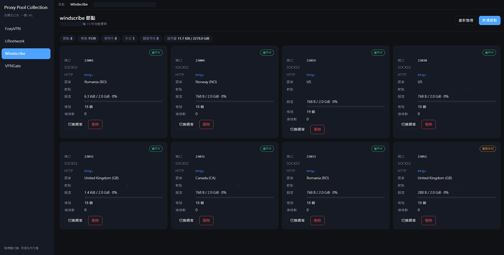
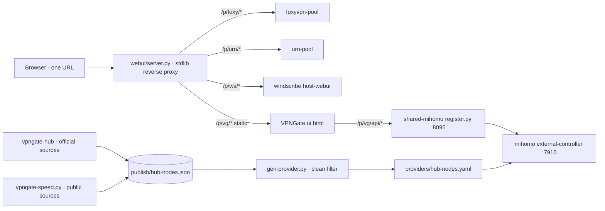

# Proxy Pool Collection

Four self-hosted proxy pools, **one URL**.

Switch between **FoxyVPN**, **URnetwork**, **Windscribe** and **VPNGate / shared-mihomo** with a left sidebar — every pool keeps its own dashboard, shown inside a single page. The repo is the **service architecture only**: no credentials, tokens, keys, accounts, or runtime state.

<p align="center">
  
</p>

> The screenshot is a live deployment with identifiers masked (host, node addresses, client uids).

## What's inside

| Tab | Source | Web UI |
|---|---|---|
| FoxyVPN | `pools/foxyvpn-pool/` — upstream subtree, pinned | upstream embedded `UI_HTML` |
| URnetwork | `pools/urn-pool/` — upstream subtree, pinned | upstream embedded `UI_HTML` |
| Windscribe | `pools/windscribe-pool/` — upstream subtree, pinned | `windscribe-host-webui/` deployed host snapshot |
| VPNGate / shared-mihomo | `shared-mihomo/` — first-party | `shared-mihomo/webui/ui.html` |

The three upstream pools are vendored **byte-identical** as git subtrees pinned to the SHAs recorded in [`docs/RECON.md`](docs/RECON.md). The fourth pool's HTTP API, mihomo config, provider generator, VPNGate hub and speed daemon are first-party, sanitized to use only the official public VPNGate node lists.

`webui/server.py` is a stdlib reverse proxy: `/` serves the tab shell, `/p/<pool>/*` proxies to that pool's configured upstream. The VPNGate dashboard is served directly at `/p/vg/`. No database, no container required, no dependency beyond Python 3.11+.

## Quickstart

```bash
cp webui/config.example.json webui/config.json
# Edit webui/config.json: each pool's upstream base URL, its tab path, and listen/port.
python3 -m unittest discover -s tests -v
python3 webui/server.py
```

Open the URL it prints. With no pool running, that tab shows an error panel and the other tabs keep working. The shell defaults to `127.0.0.1`; binding a tailnet address is an explicit opt-in.

Each shared-mihomo service ships a `config.example.env` and a unit under `shared-mihomo/{api,mihomo,hub,speed}/`. Copy each example to its gitignored runtime path, fill the placeholders, start the services. `shared-mihomo/mihomo/ovpn-template.example.json` is the placeholder for the live `ovpn-template.json`.

Credential scan (run before publishing):

```bash
python3 scripts/sanitize_scan.py
```

Every runtime value has a `*.example` companion and is gitignored. The vendored subtrees are verified by a byte-identical diff plus the documented allowlist in `docs/RECON.md`, not by the first-party scanner.

## Architecture



Two layers, both self-contained:

1. **Control plane** — each pool is a small stdlib service that turns a shared account/token pool into N per-client SOCKS5 exits (byte-relay swap, quota self-management, stable ports).
2. **Unified view** — one reverse proxy serving four tabs over the pools' own dashboards; the VPNGate pool has no quota concept, so its cards show exit node and a single **Rotate** button instead of a country picker.

## Source policy

**Included**
- Official VPNGate CSV endpoint and the official client data-file endpoint (documented as a reverse-engineered wire format on an official domain)
- A local `inbox/` for operator-supplied hosts

**Excluded**
- The third-party Android-app source whose access key/IV were extracted from a decompiled binary, its GP node pipeline and shared credentials
- The Cloudflare KV push path and its token
- Keyed/scraped risk-enrichment sources
- The OpenVPN CA/cert/key template (externalized to `ovpn-template.example.json`; live file is gitignored)

No key bytes or scraped scores are present anywhere in this repository.

## Security notes

- The shell is an **unauthenticated** reverse proxy. Its trust boundary is the network it binds (tailnet or loopback) — identical to the pools it fronts, which were already unauthenticated on the host.
- It is not an open relay: upstream URLs are built by string concatenation (no `urljoin`), traversal and protocol-relative paths are rejected, only an allowlisted header set is forwarded, `Host` is replaced, upstream 3xx is never followed server-side, and same-origin redirects are rewritten under the prefix.
- Vendored upstream sources are byte-identical to their pinned commits; the official-only VPNGate hub contains no decompiled credentials.

## Testing

```bash
python3 -m unittest discover -s tests -v
```

Playwright browser smoke (desktop + mobile, four tabs, zero JS errors):

```bash
python3 -m unittest tests.test_integration_smoke -v
```

## Credits

- [anton1615/foxyvpn-pool](https://github.com/anton1615/foxyvpn-pool) — MIT
- [anton1615/urn-pool](https://github.com/anton1615/urn-pool) — MIT
- [anton1615/windscribe-pool](https://github.com/anton1615/windscribe-pool) — MIT
- shared-mihomo, vpngate-hub, vpngate-speed, the unified web UI and the VPNGate dashboard — first-party components

Unofficial community software; not affiliated with or endorsed by Mozilla, URnetwork, Windscribe or VPNGate. Use only with accounts and subscriptions you are authorized to use.

See [`docs/RECON.md`](docs/RECON.md) for the verified inventory and [`docs/plans/`](docs/plans/) for the implementation plan.
