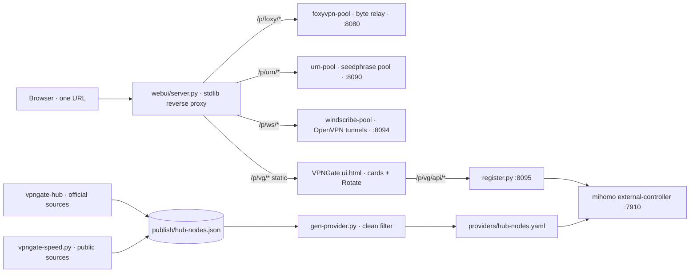

# 🗂 proxy-pool-collection

**Four self-hosted proxy pools, one URL.** `proxy-pool-collection` wraps
four existing, separate services — [foxyvpn-pool][foxy], [urn-pool][urn],
[windscribe-pool][windscribe], and a first-party shared-mihomo VPNGate pool —
behind a single stdlib **reverse proxy** and one web page: a left sidebar
switches pools with no page reload, and each pool keeps its own dashboard
(unchanged UI) inside the same tab.

<p align="center">
  
</p>

> Live deployment screenshot, identifiers masked (host, tailnet IP, port, node addresses, client uids and the unauthenticated dashboard alias). OCR-verified: zero hits for any sensitive regex.

Design borrowed from the upstream pools — same left-sidebar `UI_HTML` card
pattern, same `const BASE = location.pathname` relative-URL mounting trick —
extended with a first-party reverse proxy and a first-party VPNGate dashboard.

> Unofficial community software. Not affiliated with or endorsed by Mozilla,
> URnetwork, Windscribe, or VPNGate. Only use it with accounts and
> subscriptions you are authorized to use, in accordance with each provider's
> terms of service.

[foxy]: https://github.com/anton1615/foxyvpn-pool
[urn]: https://github.com/anton1615/urn-pool
[windscribe]: https://github.com/anton1615/windscribe-pool

## ✨ Highlights

- 🖥 **One page, four pools** — FoxyVPN, URnetwork, Windscribe and VPNGate
  behind a single URL with a left sidebar; each tab is its own dashboard,
  byte-identical upstream where a `UI_HTML` exists
- 🔁 **VPNGate is a first-party pool, not scraped wrappers** — mihomo
  `mixed` listeners, `register.py` (`/register` `/rotate` `/node` `/status`),
  a provider generator filtering the official VPNGate node lists, an official-only
  hub and a public-source speed daemon
- 🎛 **The VPNGate tab matches the others** — card-per-client, port +
  current node, alive badge, and one **Rotate** button; no quota row, because
  VPNGate has no per-account quota
- 🛡 **Hardened unified view** — fixed upstreams (no `urljoin`, no open relay),
  SSRF-traversal rejection, header allowlist, `Host` check, no server-side 3xx
  follow, same-origin `Location` rewritten under the prefix, loopback by default
- 🧾 **No credentials in the repo** — every live value lives in `*.example`
  files and a gitignored runtime set; the brand claim is *service architecture
  only*
- ⚡ **Latest release is `main`** — no containers, no database, no extra deps;
  `python3 webui/server.py` and you're looking at four dashboards

## 🤔 Why wrap pools this way?

Four pools solve four different problems, and each one already ships a good
dashboard. What's missing is the \*\*one-URL switchboard\*\* and a
reproducible, credential-free repository describing all four.

| Concern | Separate dashboards | Proxy Pool Collection |
|---|---|---|
| One status page | Visit 3–4 URLs, remember 4 tokens | One page, one URL, four sidebar tabs |
| Fresh clone reproduces | Four different repos, differing deploy docs | One clone, all four architectures versioned together |
| VPNGate dashboard | None upstream (first-party only) | Card dashboard with Rotate, matches the family |
| Credentials in repo | Each pool's README says "bring your own" | Every live value externalized; a scanner proves it |
| Upstream updates | Pull four repos, reconcile four layouts | Subtrees pinned to SHAs; update one at a time |

> The 3 upstream pools ship their own `UI_HTML`; this repo mounts them under a
> path prefix and proxies everything the relative-URL dashboard needs. The 4th
> pool's dashboard is new but copied from the same house style.

## 🧠 How it works



Two layers, both self-contained:

1. **Control planes** — each pool is a small stdlib service that turns a
   shared account/token pool into per-client SOCKS5 exits (byte-relay swap,
   quota self-management, stable ports).
2. **Unified view** — a reverse proxy serving four tabs; the VPNGate pool
   exposes no quota concept, so its cards show exit node + a single Rotate
   button (≈ urn-pool's "rotate, no picker" UX).

## 🦊 FoxyVPN / 🌀 URnetwork / 🐋 Windscribe / 🌐 VPNGate

| Tab | Source | UI |
|---|---|---|
| 🦊 FoxyVPN | `pools/foxyvpn-pool/` (subtree, pinned) | upstream embedded `UI_HTML` |
| 🌀 URnetwork | `pools/urn-pool/` (subtree, pinned) | upstream embedded `UI_HTML` |
| 🐋 Windscribe | `pools/windscribe-pool/` (subtree, pinned) | upstream embedded `UI_HTML` |
| 🌐 VPNGate | `shared-mihomo/` (first-party) | `shared-mihomo/webui/ui.html` |

Three upstream pools are vendored **byte-identical** as git subtrees pinned to
SHAs pinned in each subtree. The rewind point for every
upstream update is one subtree; the byte-identical diff is the safety net.

The VPNGate/shared-mihomo half is first-party: HTTP API (`register.py`), mihomo
config + provider generator, official-only hub (`vpngate-hub.py`), public-source
speed daemon (`vpngate-speed.py`), and the Rotate dashboard.

## 🚀 Install

Needs Python 3.11+; no other dependencies.

```bash
git clone https://github.com/anton1615/proxy-pool-collection.git
cd proxy-pool-collection
cp webui/config.example.json webui/config.json
# edit webui/config.json: each pool's upstream base URL + tab path + listen/port
python3 -m unittest discover -s tests -v
python3 webui/server.py
```

Open the printed URL (default `http://127.0.0.1:8787/`). The shell always
works: a tab whose upstream is down shows a clean error panel; the other tabs
keep working. Binding a tailnet address is an explicit opt-in in `config.json`
(`listen`), and is not automatic — the shell is an **unauthenticated** reverse
proxy and its trust boundary is the network it binds.

The 4th pool's services each ship a `config.example.env` and a systemd unit
under `shared-mihomo/{api,mihomo,hub,speed}/`:

```bash
cp shared-mihomo/api/config.example.env shared-mihomo/api/config.env
# fill in SHARED_MIHOMO_API, SHARED_MIHOMO_REG_STATE, ...
sudo systemctl enable --now shared-mihomo-reg.service
```

`shared-mihomo/mihomo/ovpn-template.example.json` is the placeholder for the
`ovpn-template.json` the generator loads at runtime.

## 🖥️ Web UI

One page; left sidebar; four tabs. Each tab is the pool's own dashboard —
no rewrite, no visual translation, because every upstream `UI_HTML` uses the
same relative-`BASE` convention.

- 🦊 FoxyVPN — clients, ports, origins, quota, region switch
- 🌀 URnetwork — clients, ports, exits, quota left, relays
- 🐋 Windscribe — cards with ports, exit, quota used, node health
- 🌐 VPNGate — cards with ports, exit node, alive badge, **Rotate** button

The screenshot at the top of this file is a live Windscribe tab.

## ⚙️ HTTP API (the 4th pool's external contract)

`register.py` (stdlib) listens on port `8095` by default and manages the mapping
`uid → local port → provider node`:

```bash
GET /register?uid=<name>   # allocate a free port, pin one random alive exit
GET /rotate?uid=<name>     # re-roll the same port to a new random exit
GET /node?uid=<name>&name=<node>  # pin a specific node
GET /nodes                  # every node name in the provider
GET /status                 # current uid → port/node mapping
GET /delete?uid=<name>      # release the port
```

All responses are JSON; no auth (trust boundary = the network, like the pools).
See `shared-mihomo/api/register.service.example` for the systemd unit.

## 🛡 Security & trust model

- The shell is an **unauthenticated reverse proxy**. Its trust boundary is the
  network it binds; there is no login, no session, no CSRF token.
- The pools themselves were already unauthenticated on the host.
- It is **not an open relay**: upstream URLs are built by string concatenation
  (no `urljoin`), `..`/leading `//` paths are rejected, only an allowlisted
  header set is forwarded, `Host` is replaced with the upstream host, upstream
  3xx is never followed server-side, and same-origin `Location` is rewritten
  back under `/p/<pool>/`.
- The VPNGate hub consumes only official public VPNGate sources — the official
  CSV endpoint and the official client data-file endpoint. No third-party
  credential extracted from a decompiled binary, no GP pipeline, no Cloudflare
  KV push, no keyed/scraped risk scoring.
- Credentials (CA/cert/key, foxyvpn tokens, urn seedphrases, windscribe accounts)
  are **never** committed; `scripts/sanitize_scan.py` enforces this for
  first-party files.
- Vendored upstream subtrees are byte-identical to their pinned commits.

## 🧩 Layout

```
.
├── README.md
├── webui/                      # the unified shell
│   ├── server.py               # stdlib reverse proxy (SSRF-safe)
│   ├── index.html              # left-sidebar tab shell
│   ├── windscribe_host.py      # serves the Windscribe host snapshot
│   └── config.example.json
├── pools/
│   ├── foxyvpn-pool/           # subtree · pinned · upstream untouched
│   ├── urn-pool/              # subtree · pinned · upstream untouched
│   └── windscribe-pool/        # subtree · pinned · upstream untouched
├── (local only, not tracked)
│   └── windscribe-host-webui/  # deployed Windscribe UI snapshot
├── shared-mihomo/             # first-party, sanitized
│   ├── api/register.py        # uid→port→node, rotate, delete
│   ├── mihomo/                # config.yaml.example, gen-provider.py, units
│   ├── hub/                   # vpngate-hub.py · official sources only
│   ├── speed/                 # vpngate-speed.py · public sources only
│   └── webui/                 # VPNGate Rotate dashboard (ui.html)
├── docs/
│   └── images/dashboard-windscribe.png   # masked
├── scripts/sanitize_scan.py
└── tests/
```

## 🧪 Tests

```bash
python3 -m unittest discover -s tests -v
```

Playwright browser smoke (desktop + mobile, four tabs, zero JS errors):

```bash
python3 -m unittest tests.test_integration_smoke -v
```

Skill note: the screenshot at the top of this file was verified by two
full-resolution OCR sweeps against every sensitive regex; the masked artifact is
what is committed, never the original.

## 🙏 Credits

- **foxyvpn-pool** by anton1615 — MIT © anton1615
- **urn-pool** by anton1615 — MIT © anton1615
- **windscribe-pool** by anton1615 — MIT © anton1615
- shared-mihomo, vpngate-hub, vpngate-speed, the unified shell and the VPNGate
  dashboard — first-party components (MIT)

Internal inventory and implementation plan are kept local and untracked; this repo ships the service architecture only.
