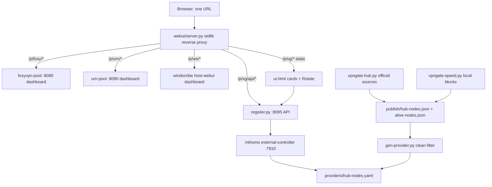
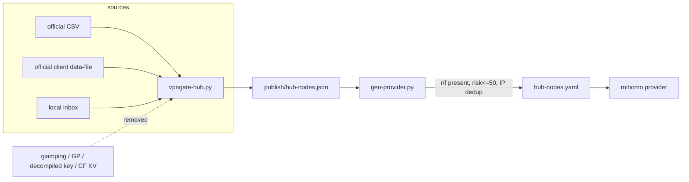

# feat: Proxy Pool Collection — four pools, one URL

## Goal Capsule

- **Objective:** An operator opens one URL and sees the live status of all four proxy pools on the host through a left-sidebar tab switcher; a fresh clone of this repo can reproduce the four service architectures with no credentials committed.
- **Means:** Three pools stay vendored unchanged as git subtrees; a new first-party `shared-mihomo/` service (sanitized) plus a stdlib reverse-proxy shell provides the fourth tab and the single URL (KTD1, KTD2, KTD3).
- **Authority hierarchy:** The user's request and `docs/RECON.md` (verified evidence) outrank any inferred convention; repo-local patterns are established by this plan; upstream pool sources are read-only inputs.
- **Stop conditions:** Any credential, private host/IP, tailnet name, decompiled key, or scraped-score material appears in a first-party file (a vendored-subtree literal is allowed only when it matches the documented KTD5 allowlist); or any of the three vendored upstream sources is modified; or the unified shell cannot serve all four tabs from one URL.
- **Execution profile:** One PR, Deep depth, 8 implementation units. `ce-work` implements and commits; the pipeline simplifies, reviews, browser-tests, pushes and opens the PR.
- **Who finishes:** The LFG pipeline ships the branch and PR; merging stays with the user.

## Product Contract

### Summary

Build a new public repo `proxy-pool-collection` that wraps the four self-hosted proxy pools. Three existing pools (foxyvpn, urn, windscribe) are vendored as-is; foxyvpn and urn ship their upstream embedded UIs, while windscribe ships the deployed host-snapshot UI (KTD4). The fourth (shared-mihomo / VPNGate) is a first-party service whose HTTP API layer, web UI, mihomo architecture, vpngate-hub and speed daemon are included, scrubbed of credentials and of the non-official/gray-area node sources. A single reverse-proxy web UI serves all four dashboards behind left-sidebar tabs at one URL.

### Problem Frame

Four pools run on one host with four separate API ports and (for three of them) four separate dashboard URLs. Checking pool health means visiting several URLs and knowing four port numbers. The first-party VPNGate pool has no dashboard at all. There is no single reproducible repository describing all four service architectures, and the VPNGate source carries node-list sources and access material that must not be published.

### Requirements

**Repo & packaging**
- R1. The repo contains three upstream pool sources under `pools/foxyvpn-pool/`, `pools/urn-pool/`, `pools/windscribe-pool/`, vendored as git subtrees pinned to the SHAs recorded in `docs/RECON.md` §6 (added in U1), byte-identical to upstream.
- R2. No credential, token, key, certificate, account, seedphrase, state file, private IP, tailnet hostname, or internal machine name is committed in first-party files. All runtime values live in `*.example` files with placeholders; real values are read from environment/CLI and are gitignored. The three vendored upstream subtrees are byte-identical public content covered by the documented allowlist in KTD5, not by a literal zero-hit claim.
- R3. A `README.md` documents the four pools, the one-URL usage, the sanitization policy, and a Credits section naming the three upstream repos (MIT) and the first-party components.

**Unified web UI**
- R4. One stdlib HTTP server `webui/server.py` serves a shell at `/` with a left sidebar of four tabs (FoxyVPN, URnetwork, Windscribe, VPNGate) and an `<iframe>` content area; clicking a tab switches the iframe without navigating away from the single URL.
- R5. The server reverse-proxies `/p/<pool>/` to the configured upstream base URL. It builds the upstream URL by string-concatenating the configured base (scheme+host+port fixed in config) with the percent-encoded path remainder — never `urljoin`; rejects any stripped path containing `..` or starting with `//`; forwards query strings; forwards an explicit header allowlist and replaces `Host` with the upstream host. It does not follow upstream 3xx server-side: `Content-Type`/`Content-Length` pass through and a same-origin `Location` is rewritten back under `/p/<pool>/` (cross-origin `Location` values are dropped). It never invents API paths.
- R6. The shell is configuration-driven: `webui/config.example.json` maps pool id → `{label, upstream, ui_path}` and carries `listen` + `port` with a `127.0.0.1` default plus a documented tailnet-address opt-in. The handler accepts only configured `Host` values. With an upstream unreachable, the tab shows a clear error panel instead of a broken iframe; the other tabs keep working.
- R7. The three existing dashboards work unmodified behind their `/p/<pool>/<ui_path>` mount, preserved with their house CSS/JS. (Evidence: all three use `const BASE = location.pathname…` relative API paths — `docs/RECON.md` §2.)

**Fourth pool — shared-mihomo**
- R8. `shared-mihomo/api/register.py` is the external HTTP API layer (`/register`, `/rotate`, `/node`, `/nodes`, `/status`, `/delete`), sanitized: state path, controller URL, bind host, port range, idle-grace values come from env/example; no live values. It keeps its error handling, idle-connection tracker, and rotate semantics.
- R9. `shared-mihomo/mihomo/` contains `config.yaml.example`, `gen-provider.py`, and a systemd unit example. `gen-provider.py` reads local publish JSON, applies the clean filter (`r`/`f` flags, `risk<=50`, IP dedup), writes `providers/hub-nodes.yaml`, and hot-reloads the controller. The embedded OpenVPN CA/cert/key template is externalized to a gitignored `ovpn-template.json` + `.example`.
- R10. `shared-mihomo/hub/vpngate-hub.py` keeps only the two official VPNGate sources (`vpngate_csv` official CSV, `vpngate_official` official client data-file) and the local inbox input. The `giamping` / `giamping_gp` source, its hardcoded AES key/IV/adsid, its fetch/parse/decrypt functions, the GP node pipeline and the `hub-gpcfg.json` publish path are removed.
- R11. `shared-mihomo/speed/vpngate-speed.py` keeps the local speed measurement and public/no-key enrichment (Cloudflare speed endpoints, `ip-api.com/batch`, X4BNet CIDR lists). The peer-block URL is parameterized via env/example; keyed `proxycheck`/`scamalytics` call shapes and HTML-scraped scores are deleted outright (KTD5). `scrub_scam()` stays only to purge the legacy column in an existing operator DB.
- R12. The Cloudflare KV push path in `vpngate-hub.py` is removed together with its token env; the hub's local publish JSON files remain the provider source (matching `gen-provider.py`). `vpngate-speed.py` falls back to building proxy blocks locally from `hub-nodes.json` when `PEER_URL` is unset.
- R13. A new single-file dashboard `shared-mihomo/webui/ui.html` shows one card per uid: uid, port, current node, alive state, and ONE **Rotate** button calling `/rotate?uid=` (no quota, no country dropdown — VPNGate has no quota). House CSS copied from urn-pool; no new dependency.

### Key Decisions

- KD1. **Vendored subtrees, not submodules** (session-settled: user-directed — chosen over git submodules: user said the three pools "基本上不用動直接包進來就好"; a fresh clone must be self-contained). Governs R1.
- KD2. **Only official VPNGate sources** (session-settled: user-directed — chosen over the gray-area third-party/decompiled sources: user said the拆包解的憑證 "不能包" and 以官方來源為主). Governs R10, R12.
- KD3. **Reverse proxy + iframe shell**, not a rewrite of four dashboards into one card renderer. Governs R4, R5, R7.
- KD4. **Rotate button, not dropdown** for the VPNGate cards, mirroring urn-pool. Governs R13.

### Success Criteria

- `git clone` → `cp` examples → `python3 webui/server.py` serves one URL with four working tabs (three upstream UIs render; VPNGate UI renders cards with Rotate).
- A sanitize scan over first-party files finds zero private IPs, tailnet names, keys, tokens, or decompiled-key constants; vendored subtrees produce only documented allowlist hits (KTD5).
- `python3 -m py_compile` passes for every shipped `.py`; `node --check` passes for the shipped JS; the sanitized hub imports with the removed-source functions absent.

### Scope Boundaries

- **In scope:** the four service architectures, the unified shell, the new VPNGate dashboard, sanitization, docs, examples, smoke tests.
- **Non-goals (considered, not built):** deploying to the live host; changing any upstream pool's behavior; adding auth/TLS to the shell (the host already gates access at the network layer and the shell defaults to loopback; no requirement calls for it, and an operator-only dashboard on a trusted network surfaces misuse immediately); keyed risk enrichment for VPNGate nodes; a fifth pool; persisting any pool's runtime state.
- **Deferred to Follow-Up Work:** reconciling the windscribe GitHub/deployment drift upstream (F1); a unified aggregated JSON health endpoint; CDN/static asset bundling.

### Open Questions

None blocking. F1 (windscribe drift) is resolved below in KTD4; it is recorded as an assumption, not a question.

## Planning Contract

### Key Technical Decisions

- KTD1. **Git subtree per upstream pool.** `git subtree add --prefix=pools/<name> <url> <sha> --squash`. Self-contained clone, upstream history squashed, sources read-only. (KD1.)
- KTD2. **Stdlib-only reverse proxy.** `ThreadingHTTPServer` + `urllib.request`; one `/p/<pool>/` route does prefix-strip, query preserve, header passthrough, and `Location` rewrite. No Flask/Nginx dependency — matches the four stdlib pool servers.
- KTD3. **Config file drives tabs and upstreams.** `webui/server.py` reads `webui/config.json` (gitignored) with four entries; `config.example.json` ships placeholders. Missing/unreachable upstream → 502 error panel for that tab only.
- KTD4. **Vendor the deployed windscribe UI outside the subtree.** Upstream `main` has no `UI_HTML` (verified: empty `git log -S'UI_HTML'`); the deployed host copy has one. Ship the deployed `wspool.py` as `windscribe-host-webui/wspool.py` (a top-level, documented, unmodified host snapshot) and point the windscribe tab at it via its own stdlib runner. The snapshot's `BASE`-relative runtime state (`state.json`, `accounts/`, `inbox/`, `logs/`, `conf/`, `serverlist.json`, `uitoken`) is gitignored by a nested `.gitignore`; it runs with `UI_TOKEN`, `BIND_HOST`, `API_PORT` set. (Assumption: the operator keeps that snapshot in sync; the upstream subtree stays byte-identical per R1.)
- KTD5. **Sanitize by externalize + delete, with an upstream allowlist.** Delete removed-source code blocks outright (no dead shims, no `TODO`); move every constant/path/host to `*.example`; gitignore all runtime artifacts. The scanner checks first-party files for: private-IP/CGNAT ranges, `ts.net`/tailnet names, a symbol denylist (`GIAMPING_`, `_aes_cbc_decrypt`, `_giamping_message`, `parse_gp_record`, `parse_gp_config`, `adsid`, `serversse`, `serversgp`, `hub-gpcfg`, `proxycheck`, `scamalytics`), PEM blocks (`-----BEGIN (CERTIFICATE|PRIVATE KEY|RSA PRIVATE KEY)-----`), `tskey-`/`ibk_`/`sk-` prefixes, 40-char opaque-token shapes, and internal machine names. No real key bytes ever appear in the scanner. Vendored subtrees are byte-identical public content (R1) verified by the subtree diff, not by the scanner; their only flagged literals are documented allowlist entries (`100.100.100.101`, `100.64.0.0/10` comments, `pool-host.example.ts.net`, `seedphrase` field names in `*.example`). Revisit the allowlist on every SHA bump.
- KTD6. **Credential-free OpenVPN template shared by generator and speed.** `gen-provider.py` loads `ovpn-template.json` at runtime; `ovpn-template.example.json` contains the public upstream template with placeholder CA/cert/key; the real file is gitignored. `vpngate-speed.py` loads the same template for the OpenVPN block only, and keeps `publish/alive-nodes.json` as its node-identity roster (that file is written with `require_sp=False` so unverified nodes can still be discovered; `hub-nodes.json` is the verified-only set). Both consume `SHARED_MIHOMO_OVPN_TEMPLATE`.
- KTD7. **One PR, eight units, dependency-ordered.** Packaging → shell → fourth-pool API → mihomo → hub trim → speed trim → VPNGate UI → verification/docs.

### High-Level Technical Design

### Assumptions

- Headless pipeline: solo-mode scoping synthesis skipped; Inferred bets recorded here.
- U1 records each upstream's pinned HEAD SHA in `docs/RECON.md` §6 at vendoring time; those SHAs are the subtree-integrity comparison target.
- The deployed windscribe `wspool.py` snapshot is the operator's current UI and may drift; the repo documents this rather than patching upstream.
- Playwright's bundled Chromium is used for the browser smoke test (no system Chrome binary).
- The mihomo binary itself is NOT vendored (it is a third-party binary); only config + generator + unit example ship.
- CF KV push removal is safe because `shared-mihomo` consumes the local publish files (verified in `docs/RECON.md` §3, §5).

### Sources / Research

- `docs/RECON.md` — verified inventory of the four pools, source legality, drift findings, and the :8095 API.
- Three upstream clones at `/tmp/lfg-recon/` (outside this repo): `UI_HTML`, `const BASE`, `/ui-state`, `RESERVED_PATHS`.
- `register.py` (:8095), `vpngate-hub.py`, `vpngate-speed.py`, `gen-provider.py`, `shared-mihomo README` — first-party sources captured from the operator host / local ops-doc snapshots; sanitized copies become the shipped files.
- Managed skill `sanitize-and-publish-github-repo` — the R2 scan categories.
- Managed skill `pool-webui-port-verify` — the `UI_HTML` port/verify pattern (py_compile + node --check + real-HTTP smoke).

## Implementation Units

### U1. Repo skeleton, vendoring, sanitization policy

- **Goal:** Establish the repo, pin the three upstream sources untouched, and set the credential-exclusion rules.
- **Requirements:** R1, R2, R3
- **Dependencies:** none
- **Files:** `.gitignore`, `pools/foxyvpn-pool/**`, `pools/urn-pool/**`, `pools/windscribe-pool/**`, `windscribe-host-webui/wspool.py`, `README.md`, `LICENSE`, `docs/RECON.md` (already present), `scripts/sanitize_scan.py`, `tests/test_sanitize_scan.py`
- **Approach:** 1. Add each upstream as a subtree pinned to its SHA and record that SHA in `docs/RECON.md` §6. 2. Ship the deployed windscribe UI snapshot under `windscribe-host-webui/` (KTD4), outside the subtree. 3. Write `.gitignore` covering `config.json`, `config.env` (not `*.env`, so `*.example.env` stays tracked), `register.json`, `ovpn-template.json`, `providers/`, `publish/`, `cache.db`, `*.pyc`, `__pycache__/`; verify `git ls-files '*.example.env'` lists all three. 4. Write `README.md` with Credits + sanitization policy + one-URL quickstart. 5. Write `scripts/sanitize_scan.py`: scan first-party files for private-IP ranges, tailnet/`ts.net` strings, key/token prefixes, and known decompiled-key constants; apply the KTD5 upstream allowlist to the vendored trees.
- **Patterns to follow:** managed skill `sanitize-and-publish-github-repo` §3.
- **Test scenarios:** scan a first-party fixture containing a `100.64.x.x` IP and a `tskey-` string → both flagged; scan the real first-party tree → zero hits; the vendored subtrees produce only documented allowlist hits; subtree files diff clean against the pinned upstream SHA.
- **Verification:** `python3 scripts/sanitize_scan.py` exits 0 on the committed tree; `git subtree` pins match `docs/RECON.md`.

### U2. Unified reverse-proxy shell

- **Goal:** One URL, four left-sidebar tabs, four proxied dashboards.
- **Requirements:** R4, R5, R6, R7
- **Dependencies:** U1
- **Files:** `webui/server.py`, `webui/index.html`, `webui/config.example.json`, `webui/windscribe_host.py`, `tests/test_reverse_proxy.py`, `tests/test_windscribe_host.py`
- **Approach:** 1. `server.py` loads `config.json` (4 entries: label, upstream, ui_path, where ui_path carries the pool's `<ui-token>` alias because foxyvpn/urn serve the UI only under that token). 2. `/` serves `index.html`; `/p/<pool>/<rest>` strips the prefix, joins by string concatenation (never `urljoin`), rejects `..`/leading `//`, forwards an allowlisted header set, replaces `Host`, and rewrites same-origin `Location` back under the prefix. 3. `index.html` renders sidebar buttons + iframe; on upstream 502 it shows an error panel. 4. `webui/windscribe_host.py` is the first-party stdlib runner that serves the KTD4 snapshot at `/`, `/ui-state`, honoring its optional `<ui-token>` prefix; the windscribe tab's `upstream` points at this runner. 5. `/p/vg/` is a static route in `server.py` serving `ui.html`; `/p/vg/api/*` proxies to `register.py`. No third server. 6. House CSS consistent with the pool dashboards.
- **Execution note:** Prove the prefix-strip with a local echo upstream before wiring real pools.
- **Patterns to follow:** the three `UI_HTML` dashboards' `const BASE = location.pathname` relative-URL convention (`docs/RECON.md` §2).
- **Test scenarios:** `/p/urn/ui-state?q=1` reaches the echo upstream as `/ui-state?q=1`; a `302 Location: /foo` becomes `/p/urn/foo`; a cross-origin `Location` is dropped; `/p/urn///evil.example/x` returns 400 and the stub upstream sees no request; an unreachable upstream returns 502 for that tab while `/` still returns 200; switching tabs changes only the iframe `src`; launch `windscribe_host.py`, browser-render `/p/ws/` and confirm cards load.
- **Verification:** real-HTTP smoke with a stub upstream + browser render of four tabs.

### U3. shared-mihomo external HTTP API (sanitized)

- **Goal:** Ship the :8095 register/rotate API with no live values.
- **Requirements:** R8, R2
- **Dependencies:** U1
- **Files:** `shared-mihomo/api/register.py`, `shared-mihomo/api/config.example.env`, `shared-mihomo/api/register.service.example`, `tests/test_register_api.py`
- **Approach:** Copy `register.py`; replace the hardcoded controller URL, port range, state path, bind host, and idle-grace defaults with `os.environ` reads; keep `_ctrl`, `_pin`, `_idle_tracker`, `_kill_idle_conns`, all routes and all error handling intact. No behavior change beyond configuration.
- **Patterns to follow:** the original `register.py`; keep its error handling unchanged (the copy is the contract).
- **Test scenarios:** with a stub controller, `/register?uid=a` allocates a free port and pins an alive node; `/rotate?uid=a` repins and returns `killed_idle_conns`; `/status` lists clients; `/delete?uid=a` frees the port; unknown uid on `/rotate` → 404; controller failure → 502 (not a crash).
- **Verification:** `py_compile` + HTTP smoke against a stub controller.

### U4. mihomo architecture + provider generator

- **Goal:** Config, generator, and unit example; credential-free OpenVPN template.
- **Requirements:** R9, R2
- **Dependencies:** U1
- **Files:** `shared-mihomo/mihomo/config.yaml.example`, `shared-mihomo/mihomo/gen-provider.py`, `shared-mihomo/mihomo/ovpn-template.example.json`, `shared-mihomo/mihomo/shared-mihomo.service.example`, `tests/test_gen_provider.py`
- **Approach:** Copy `config.yaml` → `.example` with placeholder controller/listener values; copy `gen-provider.py`, externalize the embedded `OVPN` JSON to a runtime-loaded `ovpn-template.json`; keep `clean_nodes()` filter, atomic write, `PUT /providers/proxies/hub` hot-reload, and the always-exit-0/WARNING semantics. Delete `hub-gpcfg.json` (GP) handling.
- **Patterns to follow:** managed skill `vpngate-kv-clean-pipeline` (the `r is None` veto line must survive).
- **Test scenarios:** a fixture `hub-nodes.json` with a veto node (no `r`/`f`), a proxy-flagged node, a high-risk node, and a clean node → only the clean node reaches the YAML; IP dedup drops duplicates; missing publish file → WARNING + exit 0 + old YAML preserved.
- **Verification:** `py_compile` + fixture run asserts the YAML contains exactly the clean nodes.

### U5. vpngate-hub: official-sources-only trim

- **Goal:** Remove giamping/GP/decompiled-key/CF-KV code; keep official fetchers, probing, ranking, local publish.
- **Requirements:** R10, R12, R2
- **Dependencies:** U4
- **Files:** `shared-mihomo/hub/vpngate-hub.py`, `shared-mihomo/hub/config.example.env`, `shared-mihomo/hub/vpngate-hub.service.example`, `shared-mihomo/hub/vpngate-hub.timer.example`, `tests/test_hub_sources.py`
- **Approach:** Copy the hub; delete `GIAMPING_*`, `_aes_cbc_decrypt`, `_giamping_message`, `parse_gp_record`, `parse_gp_config`, `fetch_giamping`, GP regexes/suffix/constants, `serversgp`/`hub-gpcfg.json` publish (including the `("hub:gpcfg", "hub-gpcfg.json")` entry in `PUBLISH_FILES`), and the entire CF KV push block + `cf.env`. `SOURCE_ORDER`/`FETCH_SOURCES`/`PRIORITY` reduce to `vpngate_official`, `vpngate_csv`, `inbox`. Keep `fetch_vpngate_csv`, `_rc4` official fetcher, `fetch_inbox`, probe/publish/rank logic, and the local `publish/` writes that `gen-provider.py` reads. Externalize paths/URLs to env/example.
- **Patterns to follow:** KTD5 (delete removed-source blocks outright; no shims).
- **Test scenarios:** importing the module has no `giamping`/`AES`/`CF_API_BASE` symbols; `SOURCE_ORDER` equals the three allowed sources; a round with both official fetchers stubbed publishes `hub-nodes.json` and no `hub-gpcfg.json`; a dead source does not abort the round.
- **Verification:** `py_compile` + symbol/source assertion + stubbed `--once` run.

### U6. vpngate-speed: public-source-only trim

- **Goal:** Keep local speed measurement; parameterize/optionalize gray enrichments; align with U5.
- **Requirements:** R11, R12, R2
- **Dependencies:** U5
- **Files:** `shared-mihomo/speed/vpngate-speed.py`, `shared-mihomo/speed/config.example.env`, `shared-mihomo/speed/vpngate-speed.service.example`, `tests/test_speed_sources.py`
- **Approach:** Copy the daemon; keep the single-mihomo + Cloudflare `__down` measurement, `ip-api.com/batch`, X4BNet CIDR refresh, `alive_nodes_file()`, and `scrub_scam()` (legacy-column purge only). Parameterize `PEER_URL` via env with an example placeholder; when unset, build each node's OpenVPN block locally from `alive-nodes.json` (identity) + the shared `ovpn-template.json` (KTD6). Delete the `proxycheck`/`scamalytics` call shapes, the hardcoded private peer host, and the GP-only local proxy-block builder outright. Add a smoke test asserting a speed-built block and the provider YAML agree on cipher/mtu/port/proto.
- **Patterns to follow:** the daemon's own "pure standard library; no pip installs" header.
- **Test scenarios:** with no keyed-enrichment env, a cycle measures a stub node and writes `sp_ewma` using local proxy blocks; a quality row with a legacy `scam` value is scrubbed to NULL; no `scamalytics.com`/`proxycheck`/private peer host string remains in shipped source; X4BNet failure degrades to ip-api-only; a new node present only in `alive-nodes.json` is still measured.
- **Verification:** `py_compile` + source scan + stubbed single-cycle smoke.

### U7. shared-mihomo web UI (no quota, Rotate button)

- **Goal:** The fourth dashboard, matching urn-pool's card style with a single Rotate button.
- **Requirements:** R13, R2
- **Dependencies:** U3
- **Files:** `shared-mihomo/webui/ui.html`, `tests/test_vg_ui.py`
- **Approach:** Port the urn-pool `UI_HTML` CSS verbatim. Cards show uid / port / node / alive; one Rotate button per card calls `/rotate?uid=`; no quota row, no country `<select>`. `ui.html` is served by `webui/server.py` at `/p/vg/` (static) and calls `/p/vg/api/status`, `/p/vg/api/nodes`, `/p/vg/api/rotate`. Alive comes from the mihomo controller `/providers/proxies/hub` merged by node name in `server.py`'s `/p/vg/api/ui-state` aggregator (register.py `/status` + `/nodes` carry no liveness). Relative-URL convention (`const BASE`) keeps every call under the prefix.
- **Patterns to follow:** managed skill `pool-webui-port-verify`; urn-pool `UI_HTML` markup/CSS/rotate().
- **Test scenarios:** `/p/vg/api/ui-state` returns the aggregated blob with a per-node alive flag from a stub controller; UI renders 2 stub cards (one alive, one dead) with exactly one Rotate button each and no quota/dropdown; clicking Rotate calls `/rotate?uid=` and refreshes; `node --check` on the extracted `<script>`; bad upstream → error toast, not a blank page.
- **Verification:** `node --check` + real-HTTP smoke + Playwright render/screenshot with stub `/ui-state`.

### U8. Verification, docs, and shipping hygiene

- **Goal:** Prove the whole thing end to end and leave no dead code.
- **Requirements:** R2, R3, all
- **Dependencies:** U1–U7
- **Files:** `tests/test_integration_smoke.py`, `README.md` (update), `docs/RECON.md` (link from README), `scripts/sanitize_scan.py` (run)
- **Approach:** 1. Run the sanitize scan on the full tracked tree. 2. `py_compile` every shipped `.py`. 3. `node --check` the shell + VPNGate UI scripts. 4. Start `webui/server.py`, the three real vendored/host dashboards and the VPNGate `serve.py` behind their `/p/<pool>/` prefixes, and browser-render the four tabs; screenshot. Stub only the pool backends' external API calls (`/ui-state`), never the dashboard HTML/JS. 5. Confirm every runtime value has an `.example` and is gitignored. 6. Remove throwaway fixtures/scripts.
- **Execution note:** Browser smoke is required; lfg grants that verification up front.
- **Test scenarios:** full-tree sanitize scan → zero unallowed hits (first-party clean, subtrees allowlisted); all four real dashboards render under one URL with their house CSS and relative-API calls intact; VPNGate Rotate button visible; no `TODO`/stub/shim left in shipped code.
- **Verification:** the integration smoke script exits 0; browser screenshot shows four tabs.

## Verification Contract

| Check | Command / method | Applies to | Done signal |
|---|---|---|---|
| Python syntax | `python3 -m py_compile $(git ls-files '*.py')` | all `.py` | exit 0 |
| JS syntax | extract `<script>` blocks → `node --check` | `webui/index.html`, `shared-mihomo/webui/ui.html` | exit 0 |
| Sanitize | `python3 scripts/sanitize_scan.py` | first-party files + allowlisted subtrees | zero unallowed hits |
| Unit tests | `python3 -m unittest discover -s tests -v` | U1–U7 | all pass |
| Integration | `python3 tests/test_integration_smoke.py` | U8 | exit 0 |
| Browser | Playwright: open `webui/server.py`, click 4 tabs, screenshot | R4–R7, R13 | four tabs render, Rotate visible |
| Subtree integrity | diff vendored dirs vs pinned SHAs | R1 | byte-identical |

## Definition of Done

- All eight units implemented, committed, and verified by the checks above.
- Zero credentials, private hosts/IPs, tailnet names, decompiled keys, or scraped scores in first-party files; the sanitize scan reports zero unallowed hits (first-party clean; vendored subtrees match only the KTD5 allowlist and pass the byte-identical diff).
- Three upstream subtrees unmodified; first-party hub/speed carry no removed-source symbols.
- One URL serves four tabs; the VPNGate tab has no quota and one Rotate button per card.
- Cleanup criterion: abandoned-attempt code, stub echo servers, and throwaway fixtures removed from the diff; only shipped files, examples, docs, and tests remain.
- PR opened, CI decided, residuals recorded in the PR body.
